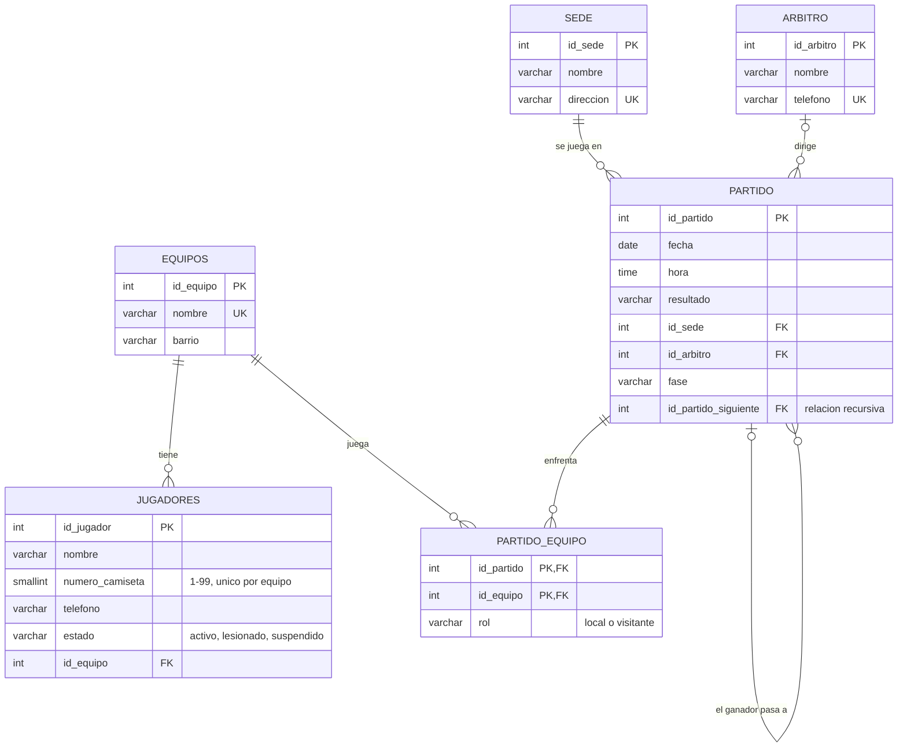

# Diagrama E-R final · Liga Barrial

El modelo tal como quedó implementado en PostgreSQL (`db/ddl.sql`).
GitHub dibuja este diagrama automáticamente. También está como imagen en `docs/diagrama_er.png`.

